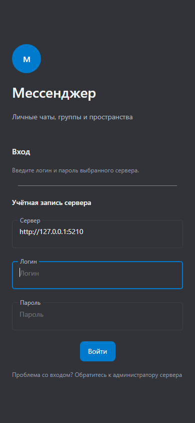

# Начало работы

Для подключения нужны адрес сервера и учётные данные. Адрес можно получить у администратора или человека, который пригласил вас в мессенджер. Для удалённого сервера используется HTTPS.

## Вход

1. Откройте Q.Sock.
2. В установленном клиенте укажите адрес сервера. Браузерная версия использует сайт, на котором открыта.
3. Введите логин и пароль.
4. Нажмите «Войти».

Если сервер разрешает самостоятельную регистрацию, на форме доступна кнопка «Создать аккаунт». Если её нет, учётную запись предоставляет администратор или подключённая система входа.

*Универсальный клиент не требует учётную запись учебного сайта на обычном сервере.* На сервере с внешним входом используйте данные, выданные для этого сервера.

## Проверка перед входом

- [ ] Устройство подключено к сети.
- [ ] Адрес сервера введён без ошибок.
- [ ] Выбрана учётная запись нужного сервера.
- [ ] Проверена раскладка клавиатуры при вводе пароля.

## Сохранённые аккаунты

В установленном клиенте можно сохранить несколько аккаунтов, в том числе для разных серверов. Переключение и удаление из сохранённых выполняется в [настройках](settings.md). В браузере аккаунты относятся к текущему серверу.

Если системное защищённое хранилище недоступно, клиент сообщает о временном сеансе: после закрытия приложения вход потребуется повторить.

После входа перейдите к [переписке](chats.md). При ошибке подключения откройте [решение проблем](../help/troubleshooting.md).
