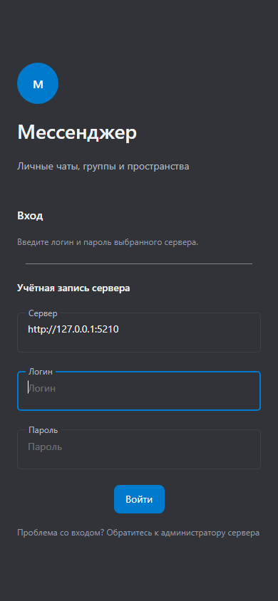

# Руководство пользователя Q.Sock

Q.Sock — мессенджер для личного и группового общения. В нём можно обмениваться сообщениями и файлами, создавать пространства с текстовыми каналами и голосовыми комнатами, участвовать в звонках. Один интерфейс используется на компьютере, телефоне и в браузере.

*Учётная запись относится к выбранному серверу.* Возможности сервера могут дополняться расширениями. Учебные функции доступны при подключённой интеграции Moodle.

## С чего начать

1. [Подключитесь к серверу и войдите](guide/getting-started.md).
2. [Откройте чат и отправьте сообщение](guide/chats.md).
3. [Подготовьте устройства для звонка](guide/calls.md).
4. [Настройте оформление и проверьте сессии](guide/settings.md).

Нажмите на изображение, чтобы перейти к инструкции по входу.

## Как пользоваться справкой

Выберите статью в меню. В приложении внутренние ссылки открываются в этом же окне справки; кнопка «Назад» возвращает к предыдущей статье. Справка загружается по сети. Уже прочитанные страницы сохраняются в кэше и доступны при временном отсутствии соединения. Внешние сайты открываются отдельно.

Если действие не удаётся выполнить, откройте раздел [«Решение проблем»](help/troubleshooting.md).
